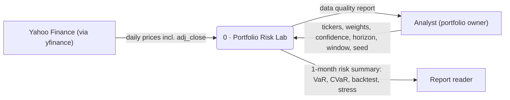
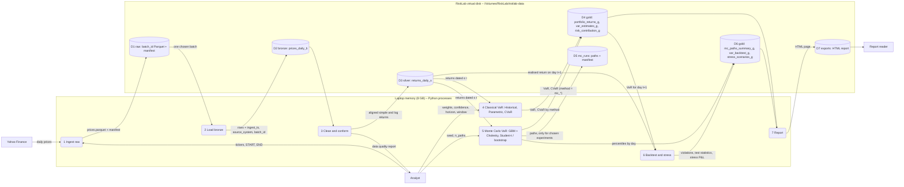

# Architecture

Portfolio Risk Lab is a small lakehouse that runs on an 8 GB laptop. It answers one question: over the next 21 trading days, what is the worst loss of a given stock portfolio at 95% / 99% confidence (VaR, CVaR), and which model estimates it best when backtested on real data. It does not forecast prices.

This page has three parts: where things live, the context diagram (DFD level 0), and the process diagram (DFD level 1).

## 1. Where things live

| Place | Holds | Never holds |
|---|---|---|
| GitHub `MartinnCo/portfolio-risk-lab` | Code, configuration, docs, notebooks with outputs | Data files (`.parquet`, Iceberg metadata, Monte Carlo paths), credentials |
| Virtual disk `RiskLab` (APFS sparse bundle, 60 GB cap, 50 GB budget) on an external drive | Repo working copy, `.venv`, uv cache, Python, all data under `RISKLAB_DATA` | Anything from other projects |
| Laptop internal disk | Nothing from this project | Repo, data, caches |

### Repository layout

```text
portfolio-risk-lab/
├── README.md
├── pyproject.toml, uv.lock, .python-version, .gitignore
├── session.sh                 # start of session: mount check, env vars, cd into repo
├── check_env.py               # environment guard
├── docs/
│   └── architecture.md        # this page
├── scripts/                   # thin entry points that run one step end to end
│   └── fetch_prices_raw.py    # process 1
├── src/portfolio_risk_lab/    # reusable logic: importable, unit-tested
│   ├── __init__.py
│   └── config.py              # tickers, dates, paths (single source of truth)
├── notebooks/                 # exploration and charts, no core logic
│   ├── 01_returns_volatility.ipynb
│   └── 02_cov_corr_drawdown.ipynb
├── sql/                       # Iceberg / DuckDB DDL (stage 2b)
└── tests/                     # pytest (stage 3)
```

Rule of thumb: logic lives in `src/`, `scripts/` only call it, `notebooks/` only explore and plot.

### Data layout

Outside the repo, at `RISKLAB_DATA = /Volumes/RiskLab/risklab-data`:

```text
risklab-data/
├── raw/yfinance/prices_daily/batch_id=<UTC>/   prices.parquet + manifest.json (append-only)
├── warehouse/                                  Iceberg tables + SQLite catalog: bronze, silver, gold, work
├── mc_runs/run_id=<id>/                        Monte Carlo paths (float32 Parquet) + manifest.json
└── exports/                                    HTML risk report, CSV extracts
```

## 2. DFD level 0 – context

Legend: rectangle = external entity, rounded box = process, cylinder = data store.



## 3. DFD level 1 – processes and stores

Processes run in laptop memory (8 GB). Every data store lives on the RiskLab virtual disk.



Look-ahead rule: every flow from D3 into processes 4–6 carries only returns dated on or before the estimation date t. Process 6 compares that VaR with the realised return of day t+1.

### Process catalogue

| # | Process | Code | Stage | Reads | Writes |
|---|---|---|---|---|---|
| 1 | Ingest raw | `scripts/fetch_prices_raw.py` | 1 (done) | Yahoo Finance | D1 |
| 2 | Load bronze | `src/portfolio_risk_lab/ingest.py` | 2c | D1 | D2 |
| 3 | Clean and conform | `src/portfolio_risk_lab/clean.py` | 2c | D2 | D3, data quality report |
| 4 | Classical VaR | `src/portfolio_risk_lab/var.py` | 3 | D3 | D4 |
| 5 | Monte Carlo VaR | `src/portfolio_risk_lab/monte_carlo.py` | 4 | D3 | D4, D5, D6 |
| 6 | Backtest and stress | `src/portfolio_risk_lab/backtest.py` | 5 | D3, D4 | D6 |
| 7 | Report | `src/portfolio_risk_lab/report.py` | 6 | D4, D6 | D7 |

Modules for stages 2c–6 do not exist yet; the names are the plan.

### Data store catalogue

| Store | Location under `risklab-data/` | Format | Size budget |
|---|---|---|---|
| D1 raw | `raw/` | Parquet per `batch_id`, append-only | 2 GB |
| D2–D4, D6 bronze / silver / gold | `warehouse/` | Iceberg, SQLite catalog | 5 GB |
| D5 mc_runs | `mc_runs/` | Parquet float32 per `run_id` + manifest | 25 GB |
| D7 exports | `exports/` | HTML, CSV | 14 GB incl. headroom |
