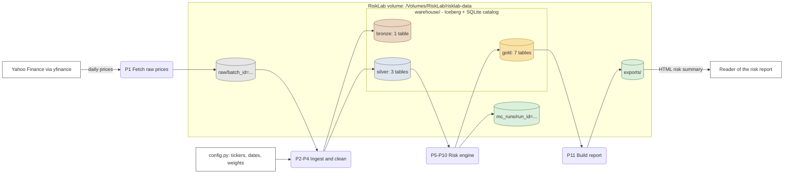
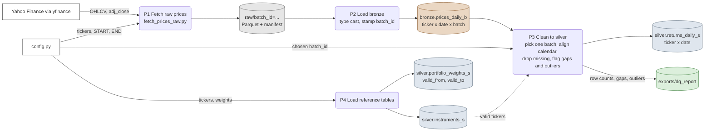
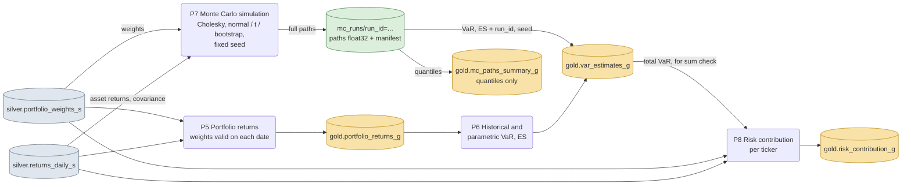
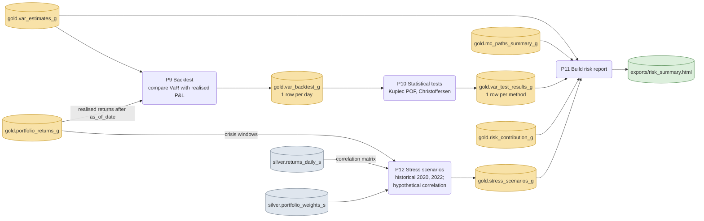

# Table-level lineage (DFD level 2)

This page breaks the level-0 and level-1 data flow diagrams in [`architecture.md`](architecture.md) down to individual tables. Table purposes, grains and keys are in [`layers.md`](layers.md). Columns are in [`data_dictionary.md`](data_dictionary.md).

**Notation**

| Shape | Meaning |
|---|---|
| Rectangle | External entity (outside the system) |
| Rounded box `Pn` | Process (a script or pipeline step) |
| Cylinder | Data store (raw folder, Iceberg table, run folder) |

Colours mark the layer: raw (grey), bronze (brown), silver (blue-grey), gold (amber), runs and exports (green).

**Status:** P1 exists (`scripts/fetch_prices_raw.py`). The other processes are planned, and the "Stage" column of the process catalogue says when each is built.

## 1. End to end

Where every store lives: everything inside the RiskLab box sits on the external drive and is never committed. GitHub holds only code and docs.

## 2. Ingestion and cleansing: raw → bronze → silver

Key points:

- Raw is append-only, and bronze keeps every batch. Only P3 decides which batch becomes the truth, which makes a rebuild reproducible.
- P3 is idempotent: rerunning it with the same `batch_id` produces the same silver tables.
- The dotted arrow is a lookup: P3 keeps only tickers listed in `instruments_s`.

## 3. Risk engine: silver → gold

Key points:

- Every estimate at `as_of_date` reads only rows with `trade_date ≤ as_of_date` (no look-ahead).
- Monte Carlo writes full paths to `mc_runs/` first. Gold gets only summaries, so gold stays small and every number traces back to a `run_id` and `seed`.
- P8 checks that per-ticker contributions sum to the total VaR in `var_estimates_g`.

## 4. Backtest, stress test and report: gold → gold → exports

Key points:

- P9 is the only process allowed to read returns **after** `as_of_date`, because comparing a forecast with what actually happened is its purpose. It records `realized_end_date` on every row.
- P10 runs formal tests on the 1-day horizon. 21-day windows overlap, so their violations are reported descriptively.

## Process catalogue

| ID | Process | Reads | Writes | Stage | Status |
|---|---|---|---|---|---|
| P1 | Fetch raw prices | yfinance, `config.py` | `raw/batch_id=…` | Session 1 | Done |
| P2 | Load bronze | raw | `bronze.prices_daily_b` | Stage 2c | Planned |
| P3 | Clean to silver | `prices_daily_b`, `instruments_s` | `returns_daily_s`, DQ report | Stage 2c | Planned |
| P4 | Load reference tables | `config.py` | `instruments_s`, `portfolio_weights_s` | Stage 2c | Planned |
| P5 | Portfolio returns | `returns_daily_s`, `portfolio_weights_s` | `portfolio_returns_g` | Stage 3 | Planned |
| P6 | Historical and parametric VaR, ES | `portfolio_returns_g` | `var_estimates_g` | Stage 3 | Planned |
| P7 | Monte Carlo simulation | `returns_daily_s`, `portfolio_weights_s` | `mc_runs/`, `mc_paths_summary_g`, `var_estimates_g` | Stage 4 | Planned |
| P8 | Risk contribution | `returns_daily_s`, `portfolio_weights_s`, `var_estimates_g` | `risk_contribution_g` | Stage 6 | Planned |
| P9 | Backtest | `var_estimates_g`, `portfolio_returns_g` | `var_backtest_g` | Stage 5 | Planned |
| P10 | Statistical tests | `var_backtest_g` | `var_test_results_g` | Stage 5 | Planned |
| P11 | Build risk report | gold tables | `exports/risk_summary.html` | Stage 6 | Planned |
| P12 | Stress scenarios | `portfolio_returns_g`, `returns_daily_s`, `portfolio_weights_s` | `stress_scenarios_g` | Stages 4–5 | Planned |

## Table → upstream (quick lookup)

| Table | Direct upstream |
|---|---|
| `bronze.prices_daily_b` | raw |
| `silver.returns_daily_s` | `bronze.prices_daily_b`, `silver.instruments_s` |
| `silver.instruments_s` | `config.py` |
| `silver.portfolio_weights_s` | `config.py` |
| `gold.portfolio_returns_g` | `returns_daily_s`, `portfolio_weights_s` |
| `gold.var_estimates_g` | `portfolio_returns_g` (historical, parametric); `mc_runs/` (Monte Carlo) |
| `gold.mc_paths_summary_g` | `mc_runs/` |
| `gold.var_backtest_g` | `var_estimates_g`, `portfolio_returns_g` |
| `gold.var_test_results_g` | `var_backtest_g` |
| `gold.risk_contribution_g` | `returns_daily_s`, `portfolio_weights_s`, `var_estimates_g` |
| `gold.stress_scenarios_g` | `portfolio_returns_g`, `returns_daily_s`, `portfolio_weights_s` |
